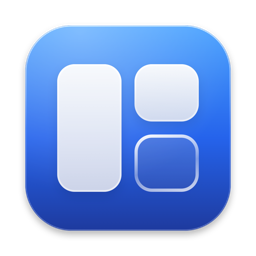

<p align="center">
  
</p>

<h1 align="center">Aero</h1>

<p align="center">
  Gerenciador de janelas para macOS que funciona como o do Windows.<br>
  Arraste até a borda, escolha a próxima janela e pronto, sem tela de configuração.
</p>

<p align="center">
  <a href="https://github.com/yagoramires/aero/releases/latest"><b>Baixar a última versão</b></a>
</p>

---

## Por que existe

Rectangle, Tiles e o encaixe nativo do macOS encaixam janelas, mas deixam de fora o que torna o
Windows prático no dia a dia: o **Snap Assist** (escolher a janela que vai ocupar o espaço que sobrou),
a **divisória compartilhada** entre janelas lado a lado e a janela **voltar ao tamanho de antes**
quando você tira ela do encaixe. O Aero faz isso e não tem nenhuma opção pra configurar.

## O que ele faz

- **Arrastar até a borda**: lateral = metade, canto = quadrante, topo = maximizar. Uma prévia
  translúcida mostra onde a janela vai parar antes de você soltar. A faixa da barra de menu também
  conta como topo, então funciona até com um monitor empilhado em cima do outro.
- **Snap Assist**: depois de encaixar, aparecem as outras janelas abertas pra ocupar o espaço livre
  (clique, ou setas + Return; Esc fecha). Ele continua oferecendo até a tela encher, e não aparece
  se o espaço já estiver ocupado.
- **Ocupa o espaço que sobrou**: se uma janela à esquerda foi alargada, a próxima encaixada à direita
  fica com o que sobrou, não com a metade fixa. Vale também para janelas posicionadas à mão.
- **Divisória compartilhada**: com janelas lado a lado, redimensionar uma ajusta a vizinha. Se a
  vizinha chegar no tamanho mínimo dela, a outra para ali, sem ficar uma por cima da outra.
- **Volta ao tamanho original**: arrastar uma janela encaixada (ou `⌘↓` numa maximizada) devolve
  o tamanho de antes do primeiro encaixe, mesmo depois de trocar de encaixe várias vezes.
- **Vários monitores**: arraste entre eles ou use os atalhos.
- **Menu na barra**: clique no ícone e escolha a posição (metades, quadrantes, maximizar, restaurar ou outro monitor), cada uma com o desenho da área que a janela vai ocupar.
- **Lembra dos encaixes** depois de reiniciar o app.
- **Atualiza sozinho**: ao abrir (e uma vez por dia) ele confere se tem versão nova no GitHub e oferece
  instalar. Também dá pra conferir em **Buscar atualizações…** no menu. A versão baixada só é
  instalada se tiver sido assinada pelo mesmo certificado do app em uso.

### Atalhos

Mesma lógica do `Win` + setas do Windows:

| Atalho | O que faz |
| --- | --- |
| `⌘ ←` / `⌘ →` | Metade esquerda/direita. De novo, vai pro monitor ao lado. A seta oposta restaura. |
| `⌘ ↑` | Maximiza. Numa metade, vai pro quadrante de cima. |
| `⌘ ↓` | Restaura a maximizada. Numa metade, vai pro quadrante de baixo. Senão, minimiza. |
| `⌘⇧` + setas | Leva a janela pro monitor daquele lado (inclusive em cima/embaixo). |

Como no Windows, os atalhos valem no sistema todo. Por isso, enquanto o Aero estiver aberto, `⌘` + setas
deixam de ir pro começo/fim da linha e do documento nos campos de texto, e `⌘⇧` + setas deixam de
selecionar até lá. No Finder, `⌘↑`/`⌘↓` deixam de navegar entre pastas.

## Instalação

1. Baixe o `Aero-x.y.z.zip` na [página de releases](https://github.com/yagoramires/aero/releases/latest),
   descompacte e arraste o **Aero.app** pra pasta **Aplicativos**.
2. Abra o Aero. Como ele não é assinado com um certificado pago da Apple, na primeira vez o macOS
   avisa que não conseguiu verificar o desenvolvedor. Vá em **Ajustes do Sistema → Privacidade e
   Segurança**, role até o fim e clique em **Abrir Mesmo Assim**.
   Pelo Terminal também resolve: `xattr -dr com.apple.quarantine /Applications/Aero.app`
3. Dê a permissão de **Acessibilidade** quando ele pedir (Ajustes do Sistema → Privacidade e
   Segurança → Acessibilidade → Aero). Ela é necessária pra mover e redimensionar janelas de outros
   apps. O Aero começa a funcionar sozinho assim que a permissão é dada.
4. Opcional: no ícone da barra de menu, marque **Abrir ao iniciar sessão**.

As próximas versões chegam pelo próprio app, que avisa e se atualiza sozinho.

**Feche outros gerenciadores de janelas** (Rectangle, Tiles, Magnet...), porque eles usam os mesmos
atalhos e o mesmo arraste. Se o encaixe nativo do macOS estiver ligado, desligue em **Ajustes do
Sistema → Mesa e Dock → Janelas → Arrastar janelas para as bordas da tela**.

Requer macOS 14 ou mais novo. Roda nativo em Apple Silicon e Intel.

## Compilar a partir do código

Só precisa das Command Line Tools (`xcode-select --install`), não do Xcode.

```sh
git clone https://github.com/yagoramires/aero.git && cd aero
scripts/setup-signing.sh   # uma vez: certificado local de assinatura (veja abaixo)
scripts/build.sh --run     # gera build/Aero.app e abre
scripts/build.sh --dist    # build universal + dist/Aero-x.y.z.zip pra publicar
```

O `setup-signing.sh` cria um certificado de assinatura local no seu Chaveiro. A permissão de
Acessibilidade fica presa à assinatura do app: com assinatura ad-hoc ela muda a cada build e o
macOS para de confiar no app. Com um certificado fixo, a permissão sobrevive às recompilações.

`scripts/make-icon.swift` gera o ícone (`Resources/AppIcon.icns`) a partir de código.

## Como funciona

| Arquivo | Papel |
| --- | --- |
| `Window.swift` | Lê e move janelas de outros apps pela API de Acessibilidade. As posições vêm do WindowServer, porque muitos apps (Electron, WebKit) demoram a atualizar a posição informada pela Acessibilidade. |
| `Geometry.swift` | Monitores, zonas de encaixe e detecção da borda sob o cursor. |
| `WindowManager.swift` | Estado dos encaixes, tamanho original, espaço livre, atalhos, divisória compartilhada e persistência. |
| `DragSnapper.swift` | Observa o mouse do sistema (event tap) pra detectar o arraste da janela e mostrar a prévia. |
| `SnapAssist.swift` | Painel com as janelas candidatas a ocupar o espaço livre. |
| `Hotkeys.swift` | Atalhos globais via Carbon (não precisam de permissão extra). |
| `Updater.swift` | Confere releases no GitHub, baixa, valida a assinatura e troca o app. |
| `Log.swift` | Log de depuração em `~/Library/Logs/Aero/`, com rotação. |
| `AppDelegate.swift` | Menu da barra, permissão e inicialização. |

### Problemas

Em **Ajuda → Reportar problema…** no menu, o Aero abre uma issue no GitHub já com a versão, o macOS
e os monitores preenchidos, e mostra no Finder o log pra você anexar. O log fica em
`~/Library/Logs/Aero/aero.log` e só registra as decisões do app (qual janela foi arrastada, pra qual
zona, por que um encaixe foi esquecido), nunca o conteúdo das janelas.

### Depuração

```sh
defaults write local.aero debugBridge -bool true   # e reabra o app
scripts/debug.sh dump        # estado em /tmp/aero-debug.txt
scripts/debug.sh left        # simula ⌘← na janela em foco (também right, up, down, screen-left...)
tail -f ~/Library/Logs/Aero/aero.log  # o que ele decidiu em cada arraste
```

## Limitações

- O Snap Assist mostra ícone e título das janelas, não miniaturas (isso exigiria a permissão de
  Gravação de Tela).
- Na borda entre dois monitores lado a lado o cursor passa direto pro outro, então ali não dá pra
  encaixar arrastando (o Windows faz igual). Use os atalhos.
- Só janelas do Space atual entram no Snap Assist.

## Licença

[MIT](LICENSE)
